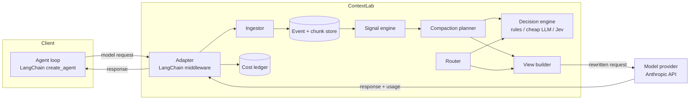
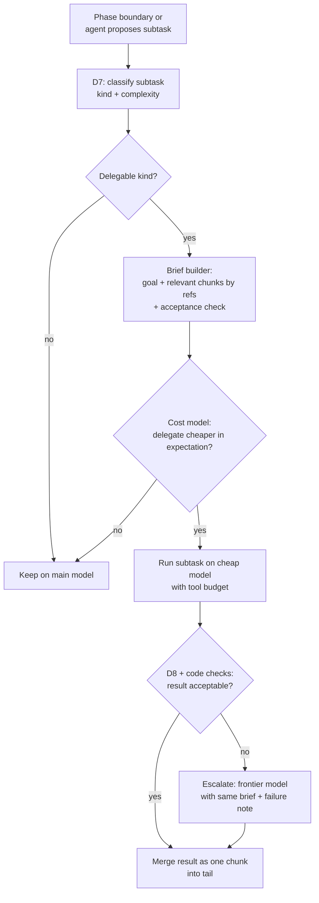

# ContextLab Architecture: Routing + Context Compaction

Status: proposed design, v0.1. Every "better than X" claim in this document is a hypothesis until the scoreboard (section 12) measures it.

## 1. What this system is

ContextLab is a decision layer that sits between an AI agent and its model provider. It makes two kinds of decisions on every agent session:

1. **Compaction:** what the model should see. Which past content stays at full size, which gets shortened, which gets hidden behind a signpost, and when to reorganize the prompt.
2. **Routing:** which model should do the work. Whether a subtask can go to a cheaper model, with what brief, and when to fall back to the frontier model.

One-line positioning: frameworks handle how to store, hide and fetch context; routers pick a model per request. ContextLab decides **what, when and where** based on what happened in the task and what each choice costs, including the prompt cache.

### 1.1 What it is not

- Not an agent framework. It reuses LangChain `create_agent`, its middleware hooks, and the Deep Agents filesystem backend.
- Not a general-purpose memory product. The fact store (section 9) exists to support long-conversation workloads, not to compete with mem0 or Zep.
- Not a per-request model router. Per-request routing is a **baseline arm** we compare against, because it throws away the prompt cache (section 7.2).

## 2. Design principles

| # | Principle | Consequence in code |
|---|---|---|
| P1 | Hide, never delete | Every original event is stored forever. Hidden content leaves a signpost and is recoverable through a recall tool. |
| P2 | Decide by what happened, not by size | Staleness comes from events (file re-read after edit, tests passed, search never referenced), not from token counts alone. |
| P3 | Price every decision | Rebuilds, hides, delegations and decision-model calls all carry an explicit expected cost and are logged with it. |
| P4 | Protect the cache prefix | The prompt has a stable prefix and an append-only tail. The prefix changes only at a rebuild, and rebuilds happen only when the cost model says they pay back. |
| P5 | Code owns rules, models own narrow judgments | Arithmetic, counting, date ordering, token counting, permissions, pairing of tool calls: always code. Fuzzy questions ("is this grep hit relevant to the goal?"): decision engine. |
| P6 | Uncertainty degrades to safe | Low-confidence decisions fall back to keep / frontier / broader retrieval, never to hide / cheap / narrower. |
| P7 | Cost per solved task is the only score | A saving that lowers the pass rate is not a saving. Decision overhead is subtracted from every reported saving. |

## 3. System context



### 3.1 Adapters

The core engine (`contextlab.core`) is framework-agnostic. It takes a normalized list of events and returns a normalized "context view" plus routing instructions. Adapters translate.

| Adapter | When | Notes |
|---|---|---|
| LangChain middleware | M0 onward (primary) | Uses `wrap_model_call` to rewrite requests and `wrap_tool_call` to observe tool results. The eval harness controls the whole loop, so measurement is clean. Verify hook names against the installed LangChain version. |
| HTTP gateway (Anthropic Messages-compatible proxy) | M6 | Lets Claude Code or any agent point `ANTHROPIC_BASE_URL` at ContextLab. Harder: see section 3.2. |

### 3.2 Why the gateway comes last

A gateway sees each request as a full message list resent by the client. To rewrite history and still keep a cache hit, the gateway must reproduce **the exact same rewritten prefix, byte for byte**, on every subsequent request of the session. That requires reliable session identification (no standard field exists; derive from a hash of system prompt + first user message, or a client header) and a stored rendered prefix per session. Mistakes here silently destroy cache hits. Build and prove the engine inside the harness first.

## 4. Core components

| Component | Owns | Key rule |
|---|---|---|
| Ingestor | Turning messages and tool results into typed events | Deterministic classification from tool name + arguments. Ambiguous `bash` output may use the decision engine. |
| Event store | Original messages and tool activity, ordered, immutable | Append-only. Never mutated, never deleted during a session. |
| Chunk store | One chunk per renderable unit (usually one tool result), with references | A chunk has an `id`, `kind`, `size_tokens`, `refs` (paths, symbols, error ids, test ids), and a visibility history. |
| Signal engine | Staleness and phase signals | Pure functions over the event stream. Unit-testable without any model. |
| Compaction planner | Visibility targets per chunk, rebuild timing | Proposes a plan; the cost model accepts or rejects it. |
| Cost model | All expected-cost arithmetic | Pure code. Prices come from `config/pricing.yaml`. |
| Router | Model choice for delegated subtasks, brief building, fallback | Never switches the main loop's model mid-session by default. |
| Decision engine | Narrow typed judgments | Pluggable: `rules`, `llm` (cheap model with structured output), `jev`. Each call logged with latency and cost. |
| View builder | Rendering the final request | Deterministic, byte-stable output. Preserves tool-call pairing. |
| Recall tool | `recall(chunk_id, offset?, limit?)` exposed to the agent | Reuses the Deep Agents filesystem backend where available. Every call is logged as a recall event. |
| Cost ledger | Per-call usage, per-decision cost, per-run totals | Records all four token types: input, cache write, cache read, output. |
| Fact store (M5) | Versioned facts, constraints, decisions for long conversations | Preserves source links and supersession chains. |

## 5. Data model

SQLite for the MVP (single file per run directory, WAL mode). Tables below are the minimum; Codex may add columns but not remove these.

```text
sessions(id, arm, task_id, run_idx, model_main, config_hash, started_at, ended_at, solved, notes)

events(id, session_id, seq, role, kind, tool_name, tool_call_id, args_json,
       content_ref, size_tokens, created_at)
  kind ∈ {user_msg, assistant_msg, file_read, file_edit, file_write, search,
          test_run, shell, recall, delegation, other}

chunks(id, session_id, event_id, kind, size_tokens, full_text_ref,
       long_text_ref, short_text_ref, signpost_text)

chunk_refs(chunk_id, ref_type, ref_value)
  ref_type ∈ {path, symbol, error_sig, test_id, search_query}

signals(id, session_id, chunk_id, signal_type, triggered_by_event_id, created_at)
  signal_type ∈ {superseded_read, resolved_test_log, unreferenced_search,
                 moved_on, subtask_done}

visibility(chunk_id, epoch_id, level)
  level ∈ {full, long, short, hidden}

epochs(id, session_id, started_at_seq, prefix_hash, prefix_tokens, reason)
  -- an epoch is the lifetime of one cache prefix; a rebuild starts a new epoch

decisions(id, session_id, seq, decision_type, engine, inputs_json, output_json,
          confidence, latency_ms, cost_usd, accepted, fallback_used)

recalls(id, session_id, chunk_id, requested_at_seq, hidden_since_epoch, tokens_returned)

model_calls(id, session_id, seq, model, purpose, input_tokens, cache_write_tokens,
            cache_read_tokens, output_tokens, cost_usd, latency_ms, cache_ttl)
  purpose ∈ {main, delegate, decision, triage, summary}

delegations(id, session_id, parent_seq, subtask_kind, model, brief_tokens,
            result_chunk_id, status, escalated_to, cost_usd)
  status ∈ {ok, failed_check, escalated, aborted}

-- M5 only
facts(id, scope, entity, property, value, unit, record_type, source_event_ids,
      effective_from, supersedes_fact_id, version, status)
  status ∈ {active, superseded, pending, conflicting}
```

## 6. Compaction

### 6.1 The prompt layout

```text
┌──────────────────────────────────────────────┐
│ 1. System prompt + tool definitions          │  identical across all arms, never changes
├──────────────────────────────────────────────┤
│ 2. Pinned task state (structured, small)     │  changes only at rebuild
├──────────────────────────────────────────────┤
│ 3. Epoch prefix: chunks rendered at the       │  frozen for the epoch → cache hit
│    visibility levels decided at last rebuild │
├──────────────────────────────────────────────┤ ← cache breakpoint
│ 4. Append-only tail: everything since rebuild │  grows normally, as in baseline
└──────────────────────────────────────────────┘
```

Rules:

- Between rebuilds, ContextLab **does not touch layers 1 to 3**. New content goes to layer 4 exactly as the baseline would send it. This is what makes ContextLab cheap to run per turn.
- Staleness signals during an epoch only update the *planned* visibility. They take effect at the next rebuild.
- Recall results arrive as normal tool results in the tail. They never rewrite the prefix.
- Cache breakpoints: one after layer 1, one after layer 3, and the provider's standard trailing breakpoint on the tail. Verify how the installed LangChain Anthropic integration places `cache_control` and set it identically in every arm.

### 6.2 Tool-call integrity (hard constraint)

Anthropic rejects requests where a `tool_use` block lacks its matching `tool_result`. Hiding a chunk therefore **replaces the content of the `tool_result` with the signpost text**; it never removes the block or its `tool_use`. A validator runs on every rendered request before it is sent and fails closed (send the baseline-equivalent request and log an error) if pairing is broken.

### 6.3 Visibility ladder

| Level | What is rendered | Typical use |
|---|---|---|
| full | Original content | Default for anything in the tail; active files |
| long | Head and tail of output plus key lines (errors, failing test names, matched lines) | Large outputs still partly relevant |
| short | 1 to 3 lines: what it was, outcome | Resolved test logs, explored-but-unused searches |
| hidden | Signpost only: `[hidden c014: read of src/auth.py @ turn 6, superseded by edit at turn 9. recall("c014")]` | Superseded file reads |

Renderings for `long` and `short` are produced by code first (deterministic extraction). An LLM summary is allowed only if code extraction is unavailable for that kind, and it must pass the fidelity check in section 8 (D11).

### 6.4 Staleness signals (code only)

| Signal | Fires when | Default target |
|---|---|---|
| superseded_read | A `file_read` of path X precedes a later edit/write of X, or a later full read of X | hidden |
| resolved_test_log | A failing `test_run` is followed by a run where the same tests pass | short |
| unreferenced_search | A `search` result's hits are not mentioned (path or symbol) in the next K assistant turns or tool args | short |
| moved_on | The agent has not referenced any of a chunk's refs for M turns and is working in a different directory or module | long |
| subtask_done | Explicit marker: todo item completed, delegation returned, or phase boundary | applies to chunks scoped to that subtask |

K and M live in `config/compaction.yaml`.

### 6.5 Phase boundaries

A rebuild is only *considered* at a phase boundary, so the cache is never churned mid-thought.

Boundary candidates (code signals): tests transition from failing to passing; the agent's working set of paths changes by more than a threshold; a todo item or delegated subtask completes; the cache is about to expire or has expired (time since last call > TTL).

Optional: the decision engine confirms ambiguous boundaries (D4). The math in 6.6 still has the final say.

### 6.6 Move-or-stay: the rebuild decision

Notation (all prices per token, from `config/pricing.yaml`):

- `P_old`: tokens in current layers 1–3
- `P_new`: tokens in layers 1–3 after the proposed rebuild
- `N`: expected remaining main-loop turns while the cache stays warm
- `r`: cache-read price; `w`: cache-write price; `i`: base input price
- `D`: decision cost of this rebuild (decision-engine calls, rendering)
- `R`: expected recall cost of the newly hidden chunks (6.7)

Warm cache:

```text
stay_cost = N · P_old · r
move_cost = P_new · w + (N − 1) · P_new · r + D + R
rebuild iff stay_cost > θ · move_cost        (θ ≥ 1 is a safety margin, default 1.2)
```

The tail grows identically in both branches, so it cancels out.

Cold cache (time since last call > TTL): staying also pays `P_old · w` on the next call, so a rebuild is almost free. Rule: if the cache is cold and `P_new < P_old`, rebuild.

Estimating `N`: use a conservative estimate (lower quantile of remaining turns from completed sessions of the same task type; a fixed config value until that history exists). Overestimating `N` is how a rebuild policy loses money, so err low.

### 6.7 Hide-or-keep: per-chunk bet

For each chunk proposed for `hidden` (or demotion to `short`):

```text
save(c)   = N · (s_full(c) − s_target(c)) · r
recall(c) = extra main-loop turn cost + recalled tokens
          ≈ (P_new + T_tail) · r + s_full(c) · i + o_avg · o_price
hide iff p_recall(c) · recall(c) < save(c)
```

Trap named explicitly: a recall is **not** just the size of the chunk. It costs an extra model turn, and that turn rereads the whole context. This is why naive hiding can raise total cost.

`p_recall(c)` sources, in priority order: (1) recall history for this chunk kind and signal from completed runs; (2) a decision-engine score (D6); (3) a config prior per signal type. Uncertain → keep.

### 6.8 Recall learning and promotion

- Every `recall` is logged with the signal that hid the chunk. Signal types whose chunks get recalled often have their prior `p_recall` raised automatically.
- Promotion: when new events reference a hidden chunk's refs (path, symbol, error signature), the chunk is marked for promotion to `long` or `full` at the next rebuild. Until then the agent can recall it directly.

### 6.9 Goal-aware triage of large outputs (M4)

When a single tool result exceeds a threshold (default 8K tokens), a cheap model reads it with the current goal (pinned task state + last user/assistant intent) and returns the indices of relevant segments. Code extracts those segments verbatim. The full output is stored as a chunk and can be recalled. Triage cost is logged as `purpose=triage` and counted against savings.

## 7. Routing

"Routing" in this system has two levels. They must not be confused.

### 7.1 Model routing: where the work runs

| Mode | What it does | Status |
|---|---|---|
| Fixed | Main loop always on frontier model | `baseline` arm behaviour |
| Per-request (naive) | Each main-loop request classified, sent to cheap or frontier model with the full history | `naive_router` baseline arm only (this is what RouteAI and most gateways do today) |
| Delegation (ContextLab) | Main loop stays on one model. At a boundary, ContextLab may carve out a subtask, send it to a cheaper model with a built brief, and merge the result back as one chunk | ContextLab default |

### 7.2 Why ContextLab does not switch models per turn

The prompt cache is per model. Switching the main loop from frontier to cheap and back means:

- the cheap model pays a full cache write of the entire history on its first call;
- the frontier model's cache may expire while the cheap model works (default TTL is short, check the provider's current value).

A cheap model rereading 80K tokens cold can cost more than the frontier model reading them warm. Per-request routing is therefore a baseline to beat, not a feature to ship. The cost model in 7.4 makes this explicit, so if per-turn routing ever wins on the scoreboard, the data will show it.

### 7.3 Delegation flow



Delegable kinds for the MVP (configurable allowlist): locate code (search + read to answer "where is X"), summarize a large output against a question, write or update a unit test for a specified function, apply a mechanical edit across files from an exact spec, run and interpret a test suite.

The brief is built by code from chunks selected by ref overlap with the subtask, capped at a token budget. The cheap model never sees the full history.

Acceptance checks are code first (tests pass, file compiles, answer cites existing paths) and decision-engine second (D8: "does this result answer the brief?").

### 7.4 Delegation cost check

```text
cost_main     = expected frontier tokens to do the subtask inline
               (approximated from history: turns × (P + T) · r + outputs)
cost_delegate = brief_tokens · i_cheap + subtask_turns · ctx_cheap · r_cheap
               + outputs_cheap + merge_tokens · (frontier write/read)
               + p_fail · (cost_main + brief_tokens · i_frontier)
               + D
delegate iff cost_delegate < cost_main / θ
```

`p_fail` comes from delegation history by subtask kind (prior from config until history exists). Failed delegations are always logged, never silently retried on the cheap model.

### 7.5 Query routing: how past context is fetched (M5)

For long-conversation workloads, a new question is routed to a retrieval strategy (J3 in the earlier design):

| Route | Code does | Decision engine helps with |
|---|---|---|
| standalone | Uses pinned state + tail only | Whether history is needed at all |
| fact_lookup | Reads active versioned facts | Resolving which entity is meant |
| historical | Hybrid search (keyword FTS + vector), expand neighbours | Relevance of candidates |
| aggregation | Enumerates records, filters, counts in code | Classifying individual records when the condition is semantic |
| mixed | Runs several routes, merges | Flagging that more than one is needed |

Route output is a set of flags (primary route, needs_history, exhaustive, exact_quote_required, scope_ambiguous), not a single label. Retrieved content is appended to the tail as a recall block, consistent with 6.1.

## 8. Decision engine and decision register

### 8.1 Interface

```python
class DecisionEngine(Protocol):
    def choice(self, question: str, options: list[str], context: str) -> Distribution: ...
    def score(self, question: str, levels: list[str], context: str) -> Distribution: ...
    def truth(self, statement: str, context: str) -> float: ...   # Jev "Noul"-style
```

Implementations: `RulesEngine` (deterministic, default), `LLMEngine` (cheap model with structured output), `JevEngine` (TypeSafe Jev; implement only against official docs; until then a stub that raises `NotConfigured`). Every call is logged to `decisions` with engine, latency, cost, confidence. Confidence below a per-decision threshold triggers the safe fallback.

### 8.2 Register

| ID | Decision | Owner | Sync/async | When uncertain |
|---|---|---|---|---|
| D1 | Event kind for ambiguous shell output | rules → engine | sync, cheap | `other`, keep full |
| D2 | Staleness signals | code only | sync | n/a |
| D3 | Ref extraction (paths, symbols, error sigs) | code (regex/AST) | sync | fewer refs = fewer signals (safe) |
| D4 | Phase boundary confirm | code signals → engine (optional) | sync at candidate boundaries only | no boundary |
| D5 | Rebuild move-or-stay | cost model (code) | sync at boundary | stay |
| D6 | `p_recall` for a chunk | history → engine score → prior | sync at boundary | keep |
| D7 | Subtask kind and delegability | engine choice | sync at boundary | keep on main |
| D8 | Delegation result acceptable | code checks → engine truth | sync | escalate |
| D9 | Triage relevance of segments | cheap model / engine score | sync on large outputs | keep `long` rendering |
| D10 | Query route + flags (J3) | engine choice + truth | sync per question (chat workload only) | broader retrieval |
| D11 | Compression fidelity (J7) | code exact checks → engine truth | sync when LLM summary used | restore original |
| D12 | Memory value / correction (J1) | engine | async after turn | keep searchable, defer |
| D13 | Fact support / revision vs conflict (J2) | engine + code validation | async | pending, keep both versions |
| D14 | Evidence sufficiency (J5) and next retrieval action (J6) | engine + code gate | sync, bounded loop | expose the gap |

Never use the decision engine for arithmetic, counting, date ordering, token counting, permissions or tool-call pairing.

### 8.3 Latency and cost budgets

- Per main-loop turn, outside boundaries: **zero** decision-engine calls. Only code runs (ingest, refs, signals).
- At a boundary: at most a configured number of engine calls (default 5) and a latency budget (default 1.5 s, measured, reported as p50/p95).
- All decision cost is added to the ContextLab arm's total. It is never reported separately as "overhead we can ignore".

## 9. Memory layer for long conversations (M5)

Scope: the conversational workload only (chat sessions with hundreds of turns, gaps longer than the cache TTL). This is where per-question retrieval is economically viable, because the cache is usually cold anyway.

- Ingest: every message stored as an event (P1). D12 decides whether to extract a fact; a negative decision never makes the message unsearchable.
- Facts are versioned: a revision creates a new version with `supersedes_fact_id`, the old one becomes `superseded`. Code never assumes "latest number wins" across different scopes; D13 decides whether it is a revision, a separate situation, or a conflict.
- Exact values (numbers, ids, amounts) are found as spans by code, chosen by the engine, copied by code.
- Unprocessed recent events are always included in retrieval, so a correction made one turn ago is visible even if extraction has not run.
- Evidence gate (D14): for each requirement of the question, track supported / missing / conflicting. "No contradiction found" is never treated as "all needed information found". Retrieval loops are bounded by rounds, time and spend in code.

## 10. Guardrails

- Fail closed: any exception in ContextLab's request rewriting sends the baseline-equivalent request and logs the error. The agent must never crash because of ContextLab.
- Spend caps: per session and per experiment, enforced in the harness. The harness estimates cost before a batch and requires confirmation above a threshold.
- Determinism: rendering is pure given (events, visibility, epoch). Same inputs produce identical bytes; tested.
- Secrets: API keys only from environment variables. Never logged, never written to run artifacts.
- Shadow mode: ContextLab computes and logs every decision and its estimated savings but sends the baseline request. Used for safe trials and for the gateway.

## 11. Observability

- Cost ledger: per call, per decision, per session; all four token types.
- Waste X-ray: for baseline runs, replay signals offline and compute the share of input spend (weighted by price type) that went to content which was stale at the time it was read. This is the ceiling on what compaction can save. Computed from the baseline arm, not the ContextLab arm.
- Session timeline: HTML report per session showing turns, epochs, rebuilds, hides, recalls, delegations, and cost per turn.
- Scoreboard: section 12.

## 12. Evaluation

### 12.1 Arms

All arms share agent code, model, system prompt, tool definitions, caching settings, task set, and seeds. An invariance test asserts byte-identical system prompt and tool definitions across arms.

| Arm | Compaction | Routing | Introduced |
|---|---|---|---|
| `baseline` | none | fixed frontier | M0 |
| `headroom` | Headroom (open-source) wrapper | fixed | M0 |
| `contextlab` | ContextLab (current milestone's features) | fixed until M3, then delegation | M0 |
| `deepagents_evict` | Deep Agents filesystem eviction (size-based) | fixed | M2 |
| `naive_router` | none | per-request classification, full history | M3 |
| `cl_compact_only` | ContextLab | fixed | M3 (ablation) |
| `cl_route_only` | none | ContextLab delegation | M3 (ablation) |
| `headroom_plus_cl` | Headroom on arrival + ContextLab late decisions | ContextLab | M4 |

Runs are interleaved across arms (round-robin per task and repeat) so API latency drift affects all arms equally.

### 12.2 Task suites

- Coding suite (primary): small repos with seeded bugs and tests. Each task has phases (investigate → fix → verify → second change) so staleness and boundaries actually occur. Include at least one **adversarial** task that needs a phase-1 detail in phase 2, to catch harmful hiding.
- Conversation suite (M5): scripted long conversations with superseded facts, questions with no keyword overlap, multi-hop questions, exhaustive counting questions, and corrections made one turn earlier.

### 12.3 Metrics

Primary: **cost per solved task** = total spend across all runs of an arm (including decision, triage and delegation cost) ÷ number of solved runs.

Also reported: pass rate with spread, median and p90 cost per run, the four token types, cache hit ratio, turns per task, recalls per task, rebuilds per task, delegation success rate, decision latency p50/p95.

Statistics: ≥3 repeats per task per arm before any comparison is called meaningful; report bootstrap confidence intervals on cost per solved task and pass rate. Results with fewer repeats are labelled "indicative only".

## 13. Known traps

| Trap | Why it bites | Mitigation |
|---|---|---|
| Rebuilding too often | Each rebuild pays a cache write on the whole prefix | Boundaries only + move-or-stay with conservative `N` |
| Underpricing recall | A recall costs a full extra turn, not just the chunk | Recall cost formula in 6.7; recall history feeds priors |
| Per-turn model routing | Cache is per model; cheap model reads history cold | Delegation with briefs; naive router kept as a baseline |
| Broken tool pairing | Provider rejects the request | Replace content, never remove blocks; validator fails closed |
| Unfair arms | Different prompts or caching make results meaningless | Invariance test; config hash logged per session |
| Decision overhead hidden | Savings look better than they are | All decision cost charged to the arm |
| Easy-case demos | "It found the budget message" proves nothing | Adversarial tasks in both suites |
| Small samples | 1–2 runs per task is noise | ≥3 repeats, confidence intervals, "indicative" label |
| Waste ceiling too low | If baseline wastes <10% on stale context, compaction cannot pay | Waste X-ray at M1 is a go/no-go gate |
| Pricing drift | Hardcoded prices go wrong | Prices only in config, verified at M0 |

## 14. Assumptions to verify at M0

1. LangChain middleware hook names and signatures in the installed version.
2. How the LangChain Anthropic integration sets `cache_control` and reports cache read/write usage.
3. Current Anthropic prices, cache TTL options and cache-write multipliers; model identifiers.
4. Deep Agents filesystem backend API and its default eviction threshold.
5. Headroom's open-source package name, LangChain integration, and licence.
6. TypeSafe Jev API (only if the `jev` engine is enabled).
