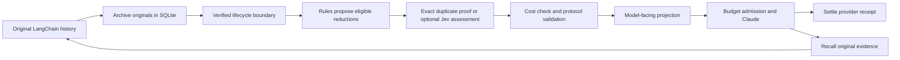

# Run ContextLab end to end

ContextLab is Python middleware for a tool-using LangChain agent. Claude performs
the task. ContextLab controls which archived tool outputs Claude sees next. Jev
can assess information loss before a proposed context reduction. SQLite records
the original outputs, decisions, provider receipts, reservations and charges.

The runnable MVP is the Python integration and evaluation tooling. Optional
[bounded evidence routing](routing.md) adds a read-only worker and five-arm
comparison. It is not an HTTP proxy, arbitrary task router or production
multi-tenant service.

For testing without provider spending, follow [offline validation](offline-validation.md).
`python -m harness xray RUN_DIRECTORY` analyzes saved baseline histories without
inference; add `--output NEW_REPORT_DIRECTORY` for HTML and JSON. The
[requirements checklist](requirements-status.md) distinguishes this MVP from the
remaining original roadmap.

## 1. Install and verify

From the repository root:

```sh
uv sync --extra headroom --frozen
.venv/bin/python -m pytest -q
.venv/bin/python -m ruff check .
.venv/bin/python -m mypy --strict contextlab/core
```

Keep `ANTHROPIC_API_KEY` and `TYPESAFE_API_KEY` in the local `.env`, following
`.env.example`. The real example loads only those allowed keys without executing
shell expansion. Exported environment values take precedence. Do not turn on
external LangSmith tracing for these local experiments.

## 2. Run the real file-reading agent

This example uses genuine Claude responses. Its bundled incident documents are
synthetic sample inputs, explicitly labeled in each file. There are no fake
provider responses in the example. It exposes read-only file tools and archive
recall; it cannot deploy, write task files or execute code, so Docker is optional.

First print the exact plan; this makes **no provider requests**:

```sh
.venv/bin/python -m examples.file_agent plan
```

The default is baseline, ContextLab + Jev, and genuine Headroom, each on identical
snapshotted files and questions. Each arm has a $1 ceiling; the shared total is
$3. These are ceilings, not predicted spend. Review the printed model, prices,
files, questions, data-sharing notice and digest before launching:

```sh
.venv/bin/python -m examples.file_agent run \
  --approve-plan PASTE_REVIEWED_DIGEST --output runs/my-file-agent-001
```

Use a new output directory each time. To research your own folder, include the
same `--files /absolute/path/to/task-files` and `--question "Your question"`
arguments in both `plan` and `run`. Only select files you intend to send to the
providers. Changes to files, code, questions, or settings invalidate approval.
For a single arm add `--arm contextlab`; for code-only decisions add
`--decision-engine rules`. Repeat `--question` for multiple conversation phases.

Open `report.html`, or inspect `summary.json`, each arm's JSON answers, and
`ledger.sqlite` under the output directory. The summary includes actual token usage and Jev fees. Failures
and conservative unknown-usage reservations remain visible. The example's answers
are **not independently graded**: finishing a question does not prove correctness,
and a lower bill does not itself prove compression savings.

## 3. Use the middleware in your own LangChain application

The reusable entry point is `contextlab.session.ContextLabSession`. It works
independently of the evaluation harness and creates a real Anthropic agent with
budget admission, token counting, disabled provider retries, receipt settlement,
the selected middleware, and archive recall.

```python
from pathlib import Path
import yaml
from langchain_core.messages import HumanMessage
from contextlab.core.models import Pricing
from contextlab.session import ContextLabSession, SessionConfig
from examples.file_agent import SYSTEM, read_tools
from harness.workspace import Workspace

# Set provider keys in your process environment before constructing the session.
# This code performs real paid inference when graph.invoke is reached.
rates = Pricing.model_validate(yaml.safe_load(
    Path("config/pricing.live.example.yaml").read_text()
))
settings = SessionConfig(pricing=rates, decision_engine="jev")

with ContextLabSession(Path("runs/my-agent/ledger.sqlite"), "my-session", settings) as session:
    graph = session.build_agent(
        tools=read_tools(Workspace("examples/data")), system_prompt=SYSTEM
    )
    state = graph.invoke({"messages": [HumanMessage(content="Read the files and explain the incident.")]})
    print(state["messages"][-1].content)
    print(session.summary())
    # After YOUR public completion checks pass:
    session.complete_phase("incident-analysis-completed")
    # Pass the full original state['messages'] into the next graph invocation.
```

For your own tools, supply LangChain `BaseTool` objects. Do not define another
`recall` tool: the session adds the same schema in all three arms. Tools are owned
by your application; the middleware does not sandbox arbitrary custom tools.

Use one active synchronous session/agent instance per session ID. Store the full
canonical LangChain conversation or use your own checkpointer. Reopening the same
ledger restores ContextLab's archive and policy state and preserves spend/call
limits; it does not recreate your graph conversation. Reusing a session ID with
different settings is rejected. An unresolved reservation blocks further calls.

For lower-level integration, use `ContextLabMiddleware` directly in
`create_agent(..., middleware=[...])`. `observe(messages)` archives canonical
messages; `project_messages(messages)` returns a model-facing copy without
invoking the task model. A configured Jev gate can still incur a decision call.
When using this low-level adapter, **you** must wire the budget/metering layer.

## 4. Understand the decisions



- An exact duplicate must match bytes and file provenance. Its replacement must
  remain fully visible. Recalled/recent/pinned outputs stay protected. Provenance
  is supplied by your trusted tool implementation; ContextLab cannot attest to an
  untrusted tool lying about its file metadata.
- Other proposed reductions may go to Jev with complete candidate content and
  retained evidence. It assesses **information lost by removal**, including
  historical values. Candidates that do not fit the request stay visible.
- Previously unassessed candidates get priority at subsequent boundaries.
  Coverage is recorded so a partially evaluated plan is not presented as complete.
- Python makes the final cost/protocol decision. Jev cannot remove new candidates,
  alter tools or instructions, do arithmetic on behalf of the budget, or approve
  its own permissions. Its threshold is experimental and uncalibrated.
- Changed tool-result content is separate from canonical history. Originals remain
  in SQLite and recall pins them. Original retention grows local disk usage.
- Reported reduction estimates use a byte heuristic. Provider receipts determine
  actual usage-derived cost. This is not invoice reconciliation or guaranteed savings.

## 5. Run the independently checked three-arm benchmark

The benchmark executes generated Python only in `contextlab-task:local` and uses
separate public and held-out checks. The file-reading example above does not need
that executor.

```sh
docker build -f Dockerfile.task -t contextlab-task:local .
.venv/bin/python -m harness check --config config/jev-validation.yaml \
  --pricing config/pricing.live.example.yaml
.venv/bin/python -m harness plan --config config/jev-validation.yaml \
  --pricing config/pricing.live.example.yaml
```

After approving that plan's $3/session, $9 total ceiling:

```sh
.venv/bin/python -m harness run --config config/jev-validation.yaml \
  --pricing config/pricing.live.example.yaml \
  --approve-plan PASTE_REVIEWED_DIGEST --output runs/my-benchmark-001
.venv/bin/python -m harness audit runs/my-benchmark-001
.venv/bin/python -m harness report runs/my-benchmark-001
```

Open the generated `report.html`. Compare pass rate, cost per solved task, actual
modified requests, failed attempts, recall and Jev overhead. All arms now have at
most two continuation attempts when output is truncated or a public deliverable
is incomplete; these consume the same original budgets and model-call limits.
No private grader answers or verdicts are fed to the agent during recovery.

`audit` is read-only and reconciles the stored receipts/ledger. It does not make
provider requests or claim to validate answer quality. A historical run retains
its original source snapshot and results; new code does not retrospectively
validate it.

## 6. Run the software image

```sh
docker build -t contextlab:local .
docker run --rm --network none contextlab:local --help
docker run --rm --network none --read-only --tmpfs /tmp \
  --mount type=volume,src=contextlab-runs,dst=/app/runs contextlab:local demo
```

This runs the existing **labeled offline mechanics demo**, with no keys or network,
and saves reports in its named volume. If the optional Compose plugin is installed,
`docker compose run --rm contextlab` provides the same flow with additional resource
limits. The development machine was verified using `docker run`; its Compose
plugin is not installed. The live sample uses the same image with a different entry point:

```sh
docker run --rm --network none --entrypoint python contextlab:local \
  -m examples.file_agent plan
```

For an actual paid run, provide provider keys only at runtime, enable networking,
mount a persistent output directory, and approve the digest printed **inside that
same image**. Host and container file paths differ, so their example plan digests
also differ. Never bake `.env` into the image. The Docker build allowlist excludes
keys, runs, `.git` and local environments. No Docker socket is mounted into the
software image; run generated-code benchmarks from the host with their separate
isolated executor.

## What remains beyond this MVP

Paid validation of this revision must follow review of its new plan. Previous
live results do not validate the updated policy. Repeatable cost/quality gains,
reliable long-task performance, broader and write-capable delegation, learned memory policies,
streaming/async integrations and a multi-tenant HTTP gateway remain separate work.
